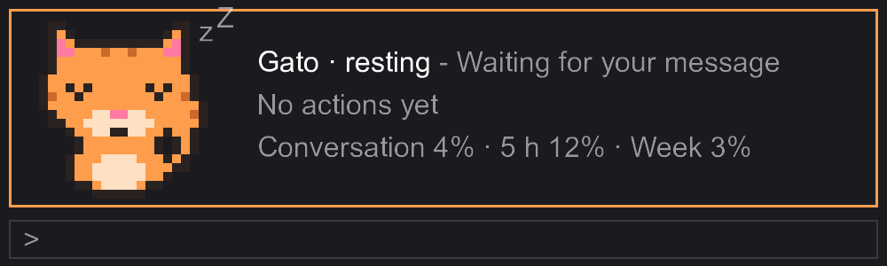
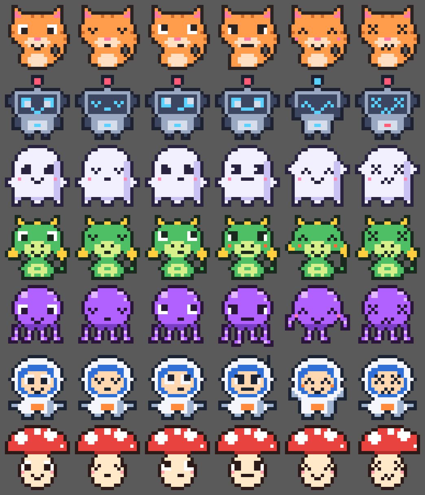

# Roco — una mascota para Claude Code

*[English](README.en.md)*



Roco es una mascota de pixel art que vive encima del cuadro de texto de Claude Code y **reacciona a lo que hace Claude**: duerme mientras esperas, piensa cuando le escribes, se pone a trabajar cuando Claude edita archivos o corre comandos, celebra cuando termina y se marea si algo falla. A su lado verás, de un vistazo, en qué anda Claude y cuánto contexto y cuota llevas.

Puedes elegir entre 8 mascotas, cambiarles el color con una palabra o **crear la tuya conversando con Claude**, en tu idioma.



*Gato, Robot, Fantasma, Dragón, Pulpo, Astronauta y Hongo, con una cara para cada ánimo. La octava es Roco, el golem de serie.*

## Requisitos

- **Claude Code** reciente, en la terminal o en la app de escritorio (pestaña *Code*). Probado con la versión 2.1.286.
- **Function hooks activados.** Si después de instalar no ves la mascota, agrega esto a `~/.claude/settings.json` y reinicia:

  ```json
  {
    "env": { "CLAUDE_CODE_ENABLE_FUNCTION_HOOKS": "1" }
  }
  ```

No funciona en el chat de claude.ai: necesita Claude Code.

## Instalación

En una terminal:

```bash
claude plugin marketplace add s4duq/roco
```

```bash
claude plugin install roco@roco
```

O, dentro de Claude Code, escribe `/plugin marketplace add s4duq/roco` y luego `/plugin install roco@roco`. Reinicia Claude Code y escribe `/roco`.

Para actualizar: `claude plugin update roco@roco`. Para quitarla: `claude plugin uninstall roco@roco`.

## Uso

La primera vez que escribes `/roco` se abre un **menú con botones**: eliges la mascota, el color, el tema, qué información ver y el tamaño. Esc lo cierra.

| Comando | Qué hace |
|---|---|
| `/roco` | Muestra u oculta la mascota (la primera vez, abre el menú) |
| `/roco menu` | Abre el menú |
| `/roco:crear [idea]` | Claude te guía para crear tu propia mascota: forma, gestos, colores y nombre |
| `/roco morado`, `/roco gato`, `/roco oceano` | Cambia el color, la mascota o el tema con una palabra |
| `/roco cambia el color a azul` | También entiende frases simples, en español o inglés |
| `/roco personaje [id]` | Sin id, lista las mascotas disponibles |
| `/roco color <nombre o #rrggbb>` | Color propio; sin valor, vuelve el del tema |
| `/roco tema <magma, oceano, bosque, lavanda, mono, auto>` | Paleta de la franja |
| `/roco estilo <completo, compacto, minimo>` | Tamaño de la franja |
| `/roco nombre <texto>` | Le pone otro nombre (máx. 16 caracteres) |
| `/roco idioma <auto, es, en>` | Idioma de los textos |
| `/roco ayuda` | Muestra todos los comandos |

Colores con nombre: morado, azul, rojo, verde, rosa, naranja, amarillo, cian, gris y blanco (también en inglés).

### Los 5 ánimos

| Ánimo | Cuándo |
|---|---|
| Reposo | Esperando tu mensaje |
| Pensando | Claude está leyendo o pensando |
| Trabajando | Claude edita archivos, corre comandos o busca |
| Listo | Claude terminó su respuesta |
| Error | Una herramienta falló o no tuvo permiso |

## Crea tu mascota

**Con Claude:** escribe `/roco:crear` seguido de tu idea (por ejemplo, `/roco:crear un zorro astronauta`). Claude te propone ideas, una expresión para cada ánimo y colores, la dibuja y la activa al instante. Puedes pedirle cambios hasta que te guste.

**Desde una imagen:** si tienes Node 22.18 o más reciente, clona este repositorio y convierte cualquier PNG o JPG en una mascota (el plugin no necesita Node; solo este conversor):

```bash
cd scripts
npm install
npm run personaje -- C:/ruta/a/mi-dibujo.png --nombre Michi
```

Se guarda en `~/.claude/roco/personajes/` y la eliges con `/roco personaje michi`. `npm run personaje -- --ayuda` muestra todas las opciones (tamaño, colores, fondo y una imagen por ánimo).

## Opciones

También puedes cambiarlas en el menú `/config` de Claude Code, en la sección del plugin.

| Opción | Por defecto | Qué hace |
|---|---|---|
| `personaje` | `roco` | Mascota activa |
| `nombre` | *(el de la mascota)* | Nombre visible |
| `tema` | `magma` | Paleta: magma, oceano, bosque, lavanda, mono o auto |
| `acento` | *(el del tema)* | Color propio `#rrggbb` |
| `estilo` | `completo` | completo, compacto o minimo |
| `campos` | `estado,acciones,uso,sesion,reinicio,contadores` | Qué información mostrar; también existe `git` (rama y cambios sin commit) |
| `idioma` | `auto` | auto, es o en |
| `avisoTurnos` | `20` | Turnos antes de sugerir una conversación nueva (0 apaga) |
| `avisoContexto` | `70` | % de contexto antes de avisar (0 apaga) |
| `avisoCuota` | `80` | % de la cuota de 5 h antes de avisar (0 apaga) |

## Privacidad

- Todo corre en tu equipo y **no se conecta a internet**.
- Las cifras de contexto y cuota las lee de Claude Code sin gastar tokens.
- Con el campo `git`, solo corre `git` en la carpeta abierta para ver la rama y los cambios pendientes.
- Solo escribe en `~/.claude/roco/personajes/`, y solo cuando creas o conviertes una mascota.
- `/roco:crear` usa tu sesión de Claude únicamente cuando tú lo pides.

## Créditos y licencia

Creado por [s4duq](https://github.com/s4duq) con ayuda de Claude Code y Antigravity.

Proyecto no oficial, sin relación con Anthropic. Licencia [MIT](LICENSE). ¿Quieres aportar una mascota? Mira [CONTRIBUTING.md](CONTRIBUTING.md).
